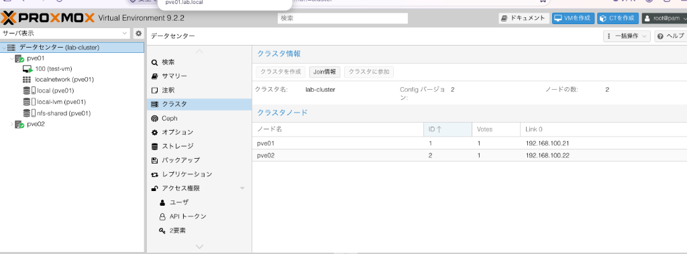
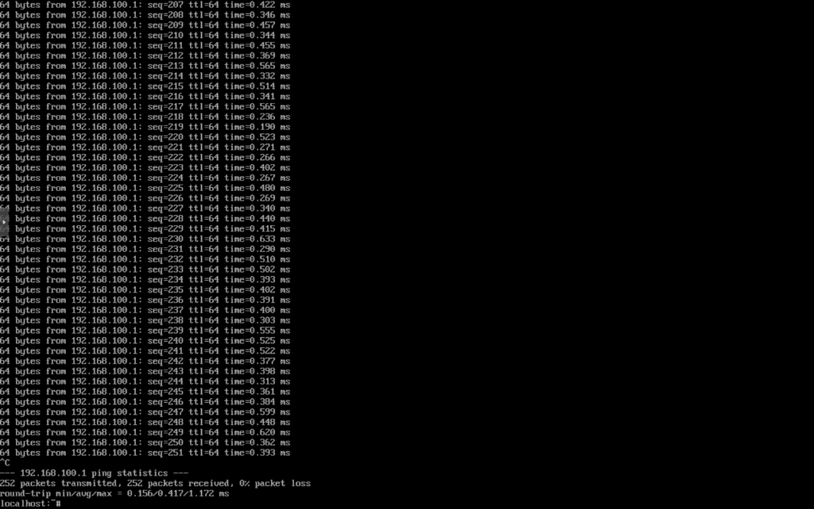
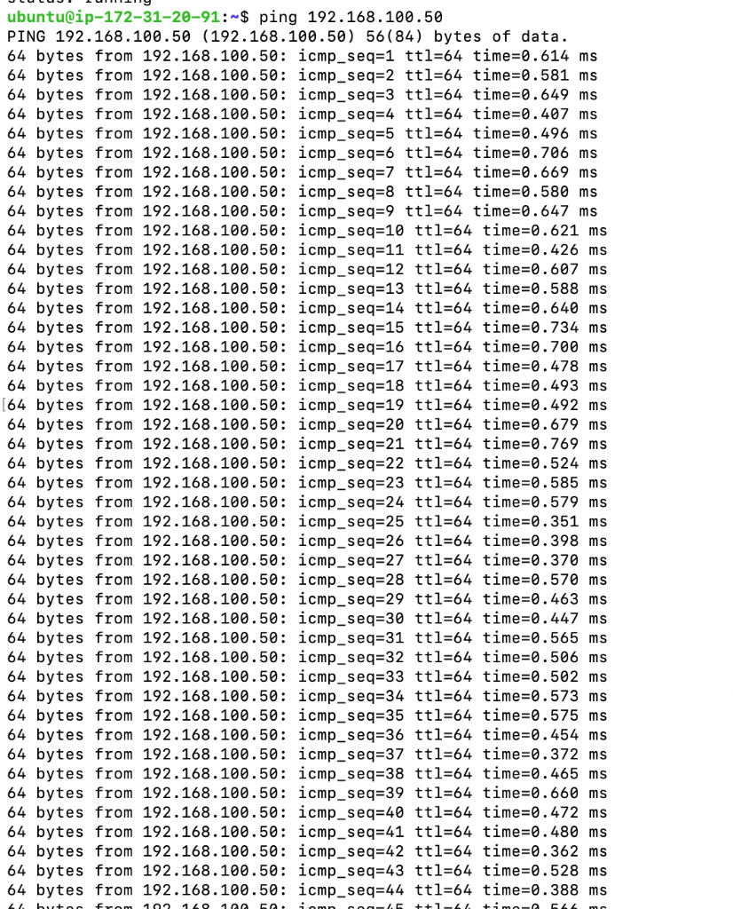
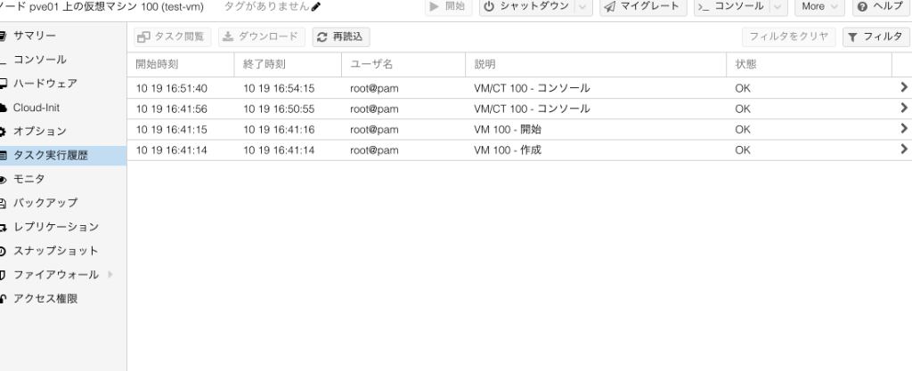
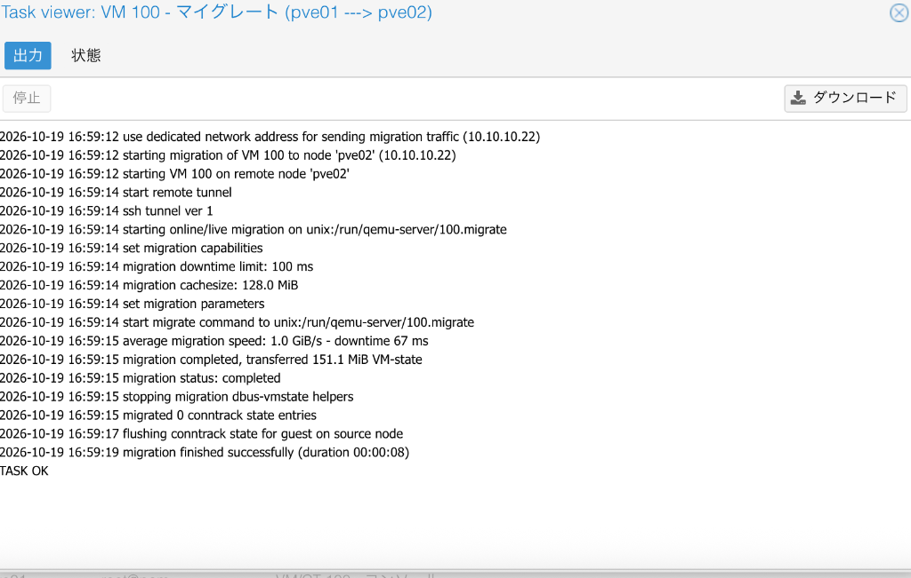
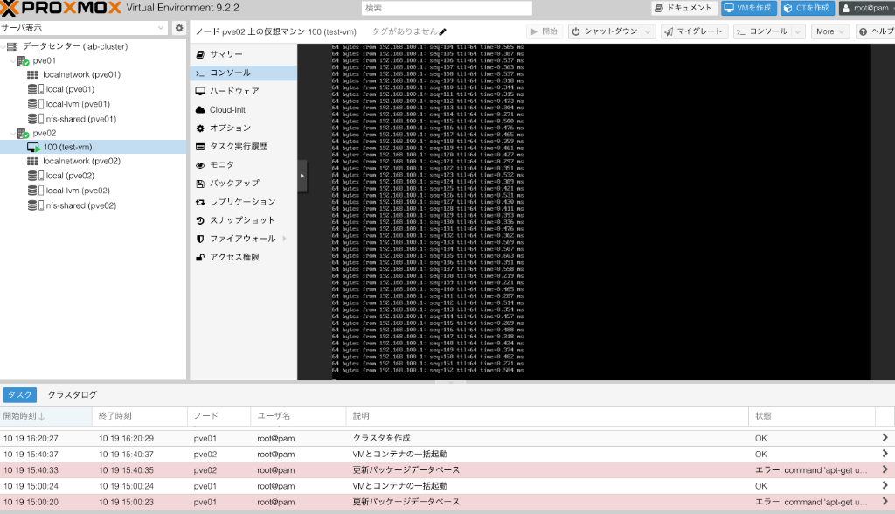

# AWSベアメタルEC2上でProxmox VE 2ノードクラスタ＋ライブマイグレーション

AWSのベアメタルEC2（`m5zn.metal`）1台の上に、KVMでProxmox VEを2台ネストで立ててクラスタを組み、
テストVMを**止めずに**隣のノードへライブマイグレーションした検証記録です。

VMware（vCenter＋vMotion）の練習を想定していましたが、VCSAはBroadcomのエンタイトルメントがないと入手できず、
無料版ESXiはvCenterに登録できないため、**無料で同じ構成を組めるProxmox VE**で代替しました。

| VMware | Proxmox VE（今回） |
|---|---|
| vCenter（一元管理） | どのノードのWeb UIからでもクラスタ全体を管理 |
| vMotion | ライブマイグレーション（オンライン移行） |
| vMotion用VMkernel | 専用の移行ネットワーク（`10.10.10.0/24`） |
| 共有データストア | NFS（`nfs-shared`） |

## 結果

| 項目 | 結果 |
|---|---|
| クラスタ | `lab-cluster`、`Nodes: 2`、`Quorate: Yes` |
| 移行 | `pve01 → pve02`、`migration finished successfully (duration 00:00:08)` |
| 停止時間（downtime） | **67 ms**（上限 100 ms、タスクログより・画像5） |
| 転送 | 151.1 MiB の VM-state を 1.0 GiB/s、移行専用ネットワーク `10.10.10.22` 経由 |
| 移行後の疎通 | test-vm 内の ping（→ 192.168.100.1）が、移行後も pve02 上で継続（画像6） |
| 費用 | 約 **$18**（税抜）：`m5zn.metal` 3.5時間 $17.90、EBS・パブリックIPv4 $0.12（Cost Explorer、東京リージョン） |

## 構成

```
Mac ──SSH(22) + ポートフォワード(5901/5902 VNC, 1080 SOCKS)──┐
                                                             ▼
EC2 m5zn.metal（Ubuntu 26.04 / KVM・NFS・DNS・NTP）
 ├─ labnet  192.168.100.0/24（NAT、管理・NFS・VM通信）
 ├─ vmnet   10.10.10.0/24  （閉域、ライブマイグレーション専用）
 ├─ pve01   192.168.100.21 / 10.10.10.21  (8vCPU / 16GB / 64GB)
 ├─ pve02   192.168.100.22 / 10.10.10.22  (8vCPU / 16GB / 64GB)
 │    └─ test-vm 192.168.100.50（Alpine、ディスクは nfs-shared 上）
 └─ NFS     192.168.100.1:/srv/nfs/pve
```

使用バージョン：Proxmox VE 9.2（ISO `proxmox-ve_9.2-1.iso`、Web UI 9.2.2）／Alpine `3.24.2` virt／Ubuntu Server 26.04 LTS

## スクリーンショット

### 1. 移行前：クラスタ2ノード、test-vm は pve01 上


### 2. 移行前：test-vm 内から ping（252送信 / 0% loss）


### 3. 移行前：ホストから test-vm へ ping


### 4. 移行前のタスク履歴（作成・起動のみ）


### 5. ライブマイグレーションのタスクログ（downtime 67 ms / TASK OK）


### 6. 移行後：test-vm が pve02 配下に移動、コンソールの ping も継続


※ 下部タスク履歴の「更新パッケージデータベース」のエラーは、サブスクリプションなしで enterprise リポジトリを参照しているためで、検証には影響しません（no-subscription リポジトリへの切り替え手順は [docs/procedure.md](docs/procedure.md) の手順3に記載）。

## ドキュメント

- [docs/procedure.md](docs/procedure.md) … 構築手順書（実際に通ったコマンドに更新済み）
- [docs/troubleshooting.md](docs/troubleshooting.md) … 実際にハマったエラーと解決方法
- [scripts/](scripts/) … 手順をまとめたスクリプト

## 次にやること

- ノード障害時の HA（自動フェイルオーバー）の検証。2ノード構成では片方が落ちるとクォーラムを失うため、QDevice（第3の投票者）を追加して確認する
- EC2 と KVM 側の構築を Terraform などでコード化し、作成から削除までを再現できるようにする

## 注意

- ベアメタルは1時間あたり数ドルかかります。検証後は必ずインスタンスを**終了（Terminate）**してください
- 秘密鍵（`.pem`）はリポジトリに入れないでください（`.gitignore` 済み）
- パスワードやパブリックIPは `<...>` のプレースホルダに置き換えています
- NFS の `chmod 777` と `no_root_squash`、Proxmox への root での SSH は、閉じたネットワーク内の検証用の設定です。本番環境では権限を絞り、専用ユーザーを使ってください
